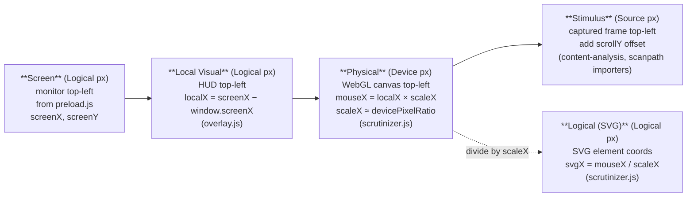
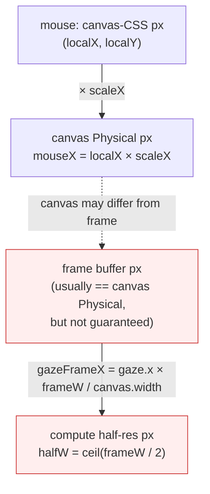

# Coordinate Systems & DPI

Scrutinizer relies on precise alignment between **four top-level coordinate spaces**, plus a fanout of sub-spaces inside the WebGL/WebGPU rendering tier. Mismatches lead to "drift" or "offsets" on High-DPI (Retina) screens, or visual artifacts where the mask, compute, and shader disagree on where a pixel sits.

## The Top-Level Pipeline



1. **Screen Coordinates (Absolute)**
   * **Source:** `preload.js` → `ipcRenderer.send('browser:mousemove', e.screenX, e.screenY)`
   * **Unit:** Logical pixels (DIPs)
   * **Origin:** Top-left of the physical monitor
   * **Why:** Bypasses browser zoom levels and internal layout shifts.

2. **Local Visual Coordinates (HUD)**
   * **Source:** `overlay.js` → `localX = screenX − window.screenX`
   * **Unit:** Logical pixels
   * **Origin:** Top-left of the HUD window (content area)
   * **Role:** Single source of truth for where the mouse is relative to the overlay.

3. **Physical Coordinates (WebGL)**
   * **Source:** `scrutinizer.js` → `targetMouseX = localX * scaleX`
   * **Unit:** Physical pixels
   * **Scaling:** `scaleX` is approximately `window.devicePixelRatio` (e.g., 2.0 on Retina)
   * **Why:** WebGL needs full resolution for crisp rendering (no aliasing).

4. **Logical Coordinates (SVG Overlay)**
   * **Source:** `scrutinizer.js` → `svgX = mouseX / scaleX`
   * **Unit:** Logical pixels
   * **Why:** SVG elements defined in HTML use CSS units (Logical).

## The Golden Rule
**"WebGL is Physical, SVG is Logical."**
When passing coordinates from the WebGL loop (Physical) back to the DOM/SVG (Logical), you **MUST** divide by the current scale factor (`this.scaleX` or `dpr`). Failure to do so results in the overlay moving 2× faster than the mouse (drift).

---

## Sub-Spaces Inside the Physical Tier

Even within the "Physical" tier, the renderer juggles **four distinct grids** that don't always have the same dimensions. CODEBASE_MAP gotcha #6 flagged this. If a conversion uses the wrong grid, the mask, compute output, and shader fragment outputs disagree about where a pixel is.

| Sub-space | Dims (typical 1920×1080 viewport, DPR=2) | Set by | Read at |
|---|---|---|---|
| **Canvas CSS** | 1920 × 1052 (viewport minus toolbar chrome) | `<canvas>` style/`getBoundingClientRect` | DOM events, `event.offsetX/Y` |
| **Canvas Physical** | 3840 × 2104 (CSS × DPR) | `canvas.width/height` (set by Scrutinizer to match the captured frame buffer) | `gl.viewport`, WebGL shaders |
| **Frame buffer** | 3840 × 2104 (or whatever Electron captured at) | `hud:frame-captured` payload from main process | `_submitCongestionFrame`, `processFrame` |
| **Compute half-res** | 1920 × 1052 (`ceil(frame / 2)`) | `webgpu-crowding-compute.js` | Tier 2.5 stats/synth, Tier 2.75 pyramid |

**The three danger sites:**



1. **Canvas height ≠ Frame height** when the toolbar chrome eats vertical pixels. `renderer/scrutinizer.js:709-710` (in `render()`, before the WebGPU compute dispatch) corrects for this explicitly:

   ```js
   const gazeFrameX = gaze.x * (frameW / this.canvas.width);
   const gazeFrameY = gaze.y * (frameH / this.canvas.height);
   ```

   **Rule:** Any code that maps gaze (canvas Physical) to frame coordinates must apply this `frameW / canvas.width` ratio. Skipping it produces a horizontal/vertical offset proportional to the toolbar height. The mask texture, congestion heatmap overlays, and any debug ring drawn in canvas Physical that needs to align with frame content must apply the same ratio.

2. **Frame → Compute half-res** is a straight `/2`, but `ceil()`-based: `halfW = Math.ceil(frameW / 2)`. For odd-width frames the last column has no fractional partner, which produces partial tiles in `crowding-stats.wgsl` (workgroup `8×8` reads beyond the half-res bound get zeros). This is harmless as long as the tile-count math for the workgroup dispatch in `webgpu-crowding-compute.js` (`tileCountX = Math.ceil(width / TILE_SIZE)`, passed to `statsPass.dispatchWorkgroups`) uses `ceil`. With `floor`, the partial last tile is never dispatched.

3. **Scanpath replay → canvas** has dataset-specific conversions on top of the above. See `renderer/scanpath/coordinate-utils.js` for three space conversions (`normalizedToPixels`, `stimulusToCanvas`, `degreesToPixels`). The AdSERP page-space ↔ screen-space conversion is in `renderer/scanpath/importers/adserp-importer.js`.

### Scroll registration

The content view scrolls natively under the HUD, so every content-locked texture is a snapshot of the page at some earlier scroll position. The renderer samples each one shifted by how far the live page has scrolled since (`shared/scroll-registration.js`, `Scrutinizer._updateScrollRegistration`).

| Texture | Source position | Stamped in |
|---|---|---|
| `u_texture` (frame) | scroll the captured pixels show | `FrameScrollRegistrar.register` (overlay.js) |
| `u_structureMap`, `u_primitiveMap`, `u_primitiveMeta` | scroll at DOM scan | preload `performScan` → `structure-update` |
| `u_saliencyMap`, `u_congestionMap` | the submitted frame's position | `ContentAnalysis` job stamps |
| `u_computeStatTexture` | the dispatched frame's position | compute readback in `render()` |

- **Units.** Scroll arrives in CSS px with the page zoom factor (`browser:scroll` x, y, zoom). Offsets are computed in DIP (CSS × zoom), divided by the canvas CSS size to give UV. A zoom mismatch between source and live yields offset 0: the page reflowed and no translation maps one layout onto the other.
- **What moves and what doesn't.** Only texture lookups shift (each sample adds its per-fragment offset, `frame_offset + uv` and so on; these equal the `u_*_offset` uniforms, plus the pane's own offset inside an inner scroller, and are zero inside a scroll-locked box). Eccentricity (uv vs `u_mouse`), the V1 noise and cell fields, and `u_maskTexture` stay screen-locked, so the fovea stays on the cursor and pooling geometry stays retinotopic. Visual-memory points are moved in canvas px on each live scroll (`VisualMemory.shiftBy`), so the mask follows the content it remembers. Gaze velocity stays screen-relative.
- **The frame's scroll comes from its pixels, not a timestamp.** main.js reads `latestBrowserScroll` before and after `capturePage`, and neither read names the pixels: the page reports a scroll a frame or more after painting it. The registrar takes the two reads as a search window and matches the new frame's banded row signatures against the last registered frame. Sticky columns vote for shift 0 and lose to the scrolling column. An unmatched frame falls back to the post-capture read but does not become the reference.
- **Exposed strip.** While the page runs ahead of the newest frame, `frameUV = uv + frame_offset` leaves [0, 1] at the leading edge. Those fragments get a LOD-5 extension of the frame's edge rows, not the live page.
- **Fixed and sticky boxes.** These hold their screen position while the page scrolls, so the shader samples every texture unshifted inside them. Preload's `DomAdapter.scanScrollLocked` reports `position: fixed` boxes, and `position: sticky` boxes that are stuck to the viewport, with every `structure-update` (viewport DIP rects). A sticky box inside an inner scroller is left out because it moves with the window scroll. A transparent wrapper with no area, or one covering more than half the viewport (toast and portal roots), is replaced by its children. The HUD clips the rects to UV (`scrollLockUvRects`, at most 16) for `u_scroll_lock`. Content whose frame position lies under a locked box, such as the strip a sticky header uncovers on a scroll back up, gets the LOD-5 fill too. Finding candidates needs computed style on every element (1.7–5.9 ms for 2.3k–14k elements), so that walk runs on mutation/initial scans and viewport resizes only. Scroll scans re-measure the cached candidates.
- **Inner scrollers.** A page that scrolls an element instead of the window registers that pane with its own offset (below).

#### Inner scrollers

Pages that scroll an element instead of the window (an `overflow: auto` pane: mail and chat lists, document viewers) register that pane separately. One pane at a time: preload's capture-phase `scroll` listener picks the element that scrolled most recently, unless a larger pane scrolled within the last 300 ms, and ignores scrollports under 64 CSS px on a side.

- **State.** `browser:inner-scroll` carries `{id, x, y, zoom, rect}`: an element id for this document, `scrollLeft`/`scrollTop` in CSS px, and the visible scrollport (inside borders and scrollbars, clipped to the viewport) in viewport DIP. main.js stamps it on both sides of `capturePage` (`pane`, `paneBefore`), and DOM scans carry it as `scanScroll.pane`.
- **Sources.** Each texture's source position carries `.pane`, the pane state it was made at. The frame's comes from `PaneScrollRegistrar`, which runs the same registrar over the pane's rows only. It registers while the pane holds still in the frame (same id and rect in both stamps, window not scrolling). Otherwise the pane stamp stands.
- **Shader.** `u_pane_rect` is the live rect in UV. A fragment inside it adds `u_<texture>_pane_offset` to its per-fragment offsets. Offsets between different panes (different `id`) or zooms are 0. The reading-span text gate takes the cursor's pane state.
- **With the scroll lock.** A locked box that holds the pane (the pane itself when it is `position: fixed`, or a fixed app shell around it) zeroes the window offset but not the pane's: the pane's content still scrolls inside it. A locked box over part of the pane (a floating toolbar) holds still against both (`inPaneLock` in the shader, `paneLockUvRects` in JS, with a 0.002 UV slack for borders). With a pane registered, `scrollLockUvRects` keeps boxes nested inside a rect that holds the pane instead of dropping them as redundant.
- **Exposed strip.** A pane fragment whose shifted sample leaves the pane's rect in the frame gets the same LOD-5 fill, taken from the pane's edge rows.
- **Elsewhere.** Compute gaze adds the pane offset when the gaze is inside the pane. Visual-memory points inside the pane move with its scroll.
- **Known limits.** One pane registers at a time; others behave as before (frames trail them). Horizontal pane scroll uses the stamps only. A sticky header inside the pane shifts with the pane's content between captures (the scroll lock covers only boxes stuck to the viewport). Pooling taps of a pane fragment near the pane's edge can reach past it while the pane runs ahead of the frame. A remembered fixation that scrolls out of the pane is drawn where it went, over whatever surrounds the pane.

### Diagnostic recipe

If something looks misaligned in production:

1. Confirm `event.offsetX === gaze.x / scaleX` (canvas-CSS ↔ canvas-Physical roundtrip).
2. Log `frameW` and `canvas.width` once per frame at the top of `processFrame()`. If they differ, the compensation at `scrutinizer.js:709-710` is what's keeping things aligned. Anything that does its own mapping must apply the same ratio.
3. For compute artifacts, check whether `tileCountX = ceil(width / 8)` matches what `pyramid-stats.wgsl` iterates. Odd-width frames are where this drifts.
